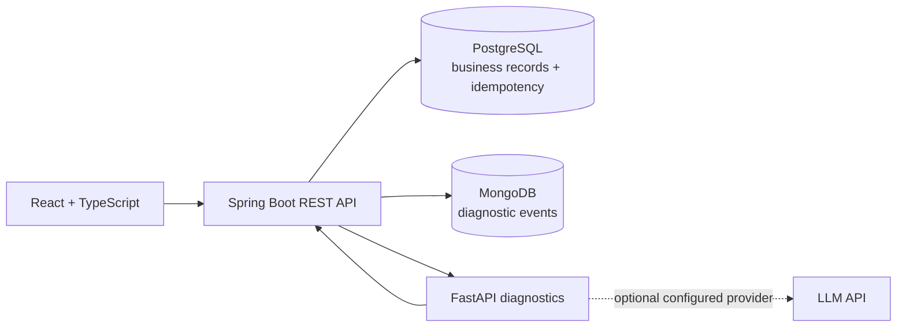

# EntitleFlow

EntitleFlow is a modular asset and entitlement operations platform. It brings customer records, physical inventory, software entitlements, order orchestration, audit events, and evidence-grounded diagnostics into one workflow.

> **Project status:** portfolio MVP in active development. The core app is runnable with Docker Compose; advanced operational controls and production identity federation remain future work.

## Architecture



The Java service owns business state and order transitions. A PostgreSQL transaction reserves inventory, creates entitlements, and advances an order. A unique idempotency key prevents duplicate submission. MongoDB is used for append-oriented operational events; PostgreSQL remains the source of truth. AI requests retrieve evidence from the application and never mutate business state.

## Stack

- Java 21, Spring Boot 3, Maven, Spring Data JPA, PostgreSQL, Flyway, Spring Security, springdoc OpenAPI
- Python 3.11+, FastAPI, pytest
- React, TypeScript, Vite
- Docker Compose and GitHub Actions

## Quick start

Prerequisites: Docker Desktop with Compose, Git, and a modern browser. For running services individually, install Java 21 with Maven, Python 3.11+, and Node.js 20+.

```bash
cp .env.example .env
docker compose up --build
```

Open the frontend at <http://localhost:5173>, API docs at <http://localhost:8080/swagger-ui.html>, and health at <http://localhost:8080/actuator/health>.

The API uses HTTP Basic credentials configured by `ADMIN_USERNAME` and `ADMIN_PASSWORD`. The Compose defaults are for local development only; replace them before exposing the app. Roles are `ADMIN`, `OPERATIONS`, and `READ_ONLY`. Configure the same `APP_USERNAME` and `APP_PASSWORD` for the diagnostic service to read order evidence. Set `LLM_API_KEY` and `LLM_MODEL` to enable a compatible OpenAI chat completion provider; otherwise the service returns a deterministic, clearly labeled evidence-based fallback.

## Demo workflow

1. Create a customer in **Customers**.
2. Register one or more assets for the product model shown in an order.
3. Submit an order using a unique `Idempotency-Key` header. The workflow validates inventory, reserves matching assets, creates entitlements, and records its transitions.
4. Inspect the order timeline, associated assets, and entitlements.
5. Ask the diagnostic assistant about the order. It retrieves the order and timeline first, then returns observed evidence, hypotheses, and next steps.

Example:

```http
POST /api/orders
Idempotency-Key: demo-order-2026-01
Content-Type: application/json

{"customerId":1,"items":[{"product":"Catalyst 9300","quantity":1,"licenseType":"SUBSCRIPTION"}]}
```

Insufficient inventory fails the order with a recorded reason. Add the needed asset, then request `POST /api/orders/{id}/retry`; completed steps are not duplicated. Retry attempts are bounded.

## API overview

| Area | Routes |
| --- | --- |
| Customers | `GET/POST /api/customers`, `GET/PUT /api/customers/{id}` |
| Assets | `GET/POST /api/assets`, `GET /api/assets/{id}` |
| Orders | `GET/POST /api/orders`, `GET /api/orders/{id}`, `POST /api/orders/{id}/retry` |
| Entitlements | `GET /api/entitlements`, `POST /api/entitlements/{id}/activate` |
| Analytics | `GET /api/analytics/overview` |
| Diagnostics | `POST /api/diagnostics/orders/{id}` (FastAPI, port 8000) |

Springdoc publishes the full schema and interactive API at `/swagger-ui.html`.

## Development

Run individual services:

```bash
cd backend && mvn spring-boot:run
cd ai-service && python -m venv .venv && .venv/Scripts/activate && pip install -r requirements.txt && uvicorn app.main:app --reload --port 8000
cd frontend && npm install && npm run dev
```

Run checks:

```bash
cd backend && mvn test
cd ai-service && pip install -r requirements.txt && pytest
cd frontend && npm ci && npm run build && npm test
```

Database schema is managed by Flyway on backend startup. Compose provisions PostgreSQL and MongoDB. See `.env.example` for all settings.

## Engineering decisions and limitations

- An order submission is atomic for the local PostgreSQL workflow. Row-level pessimistic locks protect matching available assets; the unique idempotency key is scoped to the order table. A retry only restarts failed orders and has a bounded attempt count.
- MongoDB event writes are best-effort and do not replace relational transition history; a database transaction cannot atomically commit across PostgreSQL and MongoDB. Reconciliation is an operational follow-up for gaps.
- LLM output is constrained to a structured response, but remains advisory. Retrieved data is explicitly treated as untrusted evidence, and no AI output can trigger an action.
- The included Basic authentication is suitable for a local portfolio demonstration. Production deployments should use TLS, managed secrets, and an identity provider with short-lived tokens and account lifecycle controls.
- Testcontainers-backed persistence and concurrent allocation tests are not included in this initial MVP. The service has focused unit and API tests; production-grade recovery, monitoring, and broader UI coverage are follow-up work.

## Security

Never commit `.env`. Rotate local demo credentials before sharing a deployment. CORS is configurable with `CORS_ALLOWED_ORIGINS`. The backend hashes configured passwords with BCrypt and gates writes by role. The AI service does not receive credentials for write APIs and never stores the LLM key in logs.
